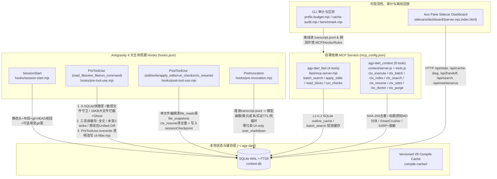

# `agy-dart` — AI 审阅技术简报（AI Review Brief）

> **本文档用途**：面向代码审阅 AI / 架构审计 AI / 安全审查 AI 的高密度项目总览与审阅路线图。所有文件路径、行数、环境变量、不变量与验证命令均基于当前工作区实测状态（v1.2 开发态；`package.json` 尚未 bump 版本号，仍为 `1.1.0`）。

---

## 1. 项目一句话定位与硬约束（Hard Invariants）

**`agy-dart`** 是面向 **Google Antigravity**（Desktop 2.0 / IDE / CLI）的原生一体化插件，将 **极速批处理加速引擎 (`agy-dart_fast`)**、**沙盒过滤与 SQLite FTS5 上下文护栏 (`agy-dart_context`)**、**4 个生命周期 Hooks**、**服务端 Prompt Cache / KV-Cache 诊断与回放体系** 以及 **Aux Pane 实时 Sidecar 仪表盘** 融合成单一插件。

### 审阅时必须核验的 8 条硬不变量

| # | 硬不变量 | 验证位置 |
| :-: | :--- | :--- |
| 1 | **零运行期 npm 依赖**：仅使用 Node.js `>= 22` 内置模块（`node:sqlite`、`node:zlib`、`node:crypto`、`node:module` 等），`package.json` 无 `dependencies` | `package.json` |
| 2 | **严格 MIT 净室合规**：严禁引入 ELv2 / BUSL-1.1 / AGPL-3.0 / Apache-2.0 源码，所有借鉴模式须为净室实现并登记于声明文件 | `THIRD_PARTY_NOTICES.md`、`LICENSE` |
| 3 | **MCP 单次响应严格 `<= 8.8 KB` UTF-8**：防止 Antigravity 将超限 MCP 输出落盘 `output.txt` 造成二次读取；截断不得劈裂 UTF-8 多字节（尤其 CJK） | `fast/mcp-server.mjs`、`context/lib/tools.js`、`hooks/filter-rules.mjs` |
| 4 | **JSON-RPC stdio 零污染**：两个 MCP 服务（含 V8 编译缓存激活与 SQLite L2 持久化缓存）在冷/热启动及异常 fail-open 时，均不得向 `stdout`/`stderr` 输出任何杂音 | `fast/mcp-server.mjs`、`context/server.js`、`hooks/compile-cache.mjs` |
| 5 | **Turn-0 前缀确定性与预算封顶**：双 MCP `tools/list` 必须按键名与工具名规范排序（`canonical = true`）、两次握手 SHA-256 一致；常驻 Turn-0 总估算 `<= 4,000` tokens | `scripts/prefix-budget.mjs`、`scripts/cache-audit.mjs`、`context/lib/stable-json.js` |
| 6 | **中段 Hook 零前缀污染**：`PreInvocation` 告警必须输出 `systemMessage: ""` + `metadata.user_markdown`，严禁向模型注入动态文本破坏服务端 KV-Cache | `hooks/pre-invocation.mjs` |
| 7 | **钩子严格 Fail-Open 与 0-SQLite 快路径**：任何 Hook 遇到 DB 锁/权限/异常都必须放行；`read_file` 对 `SKILL.md`/`AGENTS.md`/附件/二进制及未受管工具不得打开或创建 SQLite DB | `hooks/pre-tool-use.mjs`、`hooks/post-tool-use.mjs`、`hooks/session-start.mjs` |
| 8 | **安全边界**：`ctx_index(url)` 强制 SSRF 逐跳 DNS 校验与 IP Pinning；CLI 过滤严禁放行未授权 Shell 注入（管道/重定向/子 Shell/命令串联）；仓库 `.agy-dart/filters.json` 须拒收 ReDoS 正则；Sidecar 前端防 XSS | `context/lib/security.js`、`hooks/filter-rules.mjs`、`sidecars/dashboard/index.html` |

---

## 2. 架构与控制流总览



---

## 3. 代码地图（按子系统与精确规模）

### 3.1 核心库 (`context/lib/`)

| 文件 | 行数 | 核心职责与关键导出 |
| :--- | ---: | :--- |
| `context/lib/store.js` | 2,646 | `ContextModeStore`：SQLite WAL + FTS5（Porter BM25 + Trigram RRF）、标题感知 Markdown 分块、SHA-256 去重、会话读写去重（`file_reads`）、gzip 快照（`file_snapshots`）、大纲持久化（`outline_cache`）、`repo_cache`、Ghost Registry、结构化检查点（`session_checkpoints`）、TTL 清理与 `VACUUM` |
| `context/lib/cache-analyzer.js` | 2,424 | Transcript KV-Cache 诊断引擎：`MODEL_CACHE_PROFILES`（含 Gemini 4/Neon/Carbon/Argon/Hydrogen、Claude 4 系列等）、`extractStepMaxTokenLimit`、多厂商 `extractStepTokenUsage`（防重复计数）、写溢价 `estimateCostSavingsPct` 与 USD 成本、实证 TTL 自适应校准、7 桶 `contextComposition`、`subagentBreakdown`、死循环/震荡监控 `loopWatch`、6 类 Bust 归因 |
| `context/lib/cache-simulator.js` | 1,185 | 离线策略回放引擎：`simulateCachePolicies`、`formatSimulationMarkdown`；基于真实历史轨迹回放对比 7 套策略（`observed`、`ttl-5m`、`ttl-1h`、`cold-boundary-compact`、`cutoff-strict-8k/balanced-16k/relaxed-32k`）并输出推荐策略 |
| `context/lib/repo-skeleton.js` | 1,036 | `git HEAD` 缓存的核心依赖枢纽扫描：支持 JS/TS（含 JSONC `tsconfig` `paths` 别名）、Python、Rust、Go（`go.mod`）、Vue/Svelte、Dart（`pubspec.yaml`）、Java；采用确定性优先级分层 BFS（优先 `src`/`lib`/`packages` 等核心目录） |
| `context/lib/json-crusher.js` | 852 | 零依赖可逆 JSON/JSONL 结构化粉碎器：`isJsonLike`、`smartCrushJson`；提取大数组 Schema/类型/空值统计 + 首尾样本 + 异常项（`error`/`fail`/`status>=400` 等，排除良性 `error:null`），深层对象骨架保留，附带 FTS5 `sourceId` |
| `context/lib/tools.js` | 792 | `agy-dart_context` 8 个 MCP 工具实现；`ctx_execute`/`ctx_batch`/`ctx_index` 均启用 `dedup: true`；`ctx_execute` 接入 `smartCrushJson`；统一 `capSerializedJsonField <= 8.8 KB` UTF-8 封顶 |
| `context/lib/security.js` | 526 | `validateFetchTarget`（SSRF 协议白名单、逐跳 DNS 私网/回环/链路本地/IPv6 拦截与 IP Pinning）、`redactSecrets`（常见密钥/私钥/连接串脱敏）、`detectSensitiveFile`（敏感凭据文件守卫） |
| `context/lib/handoff.js` | 494 | 缓存友好交接摘要生成器：`buildHandoffBrief`；聚合分支 + 有界 `git diff --stat`、`sessionCheckpoint`、FTS5 `sourceId`、KV-Cache 状态与脱敏，严格 UTF-8/CJK 封顶 |
| `context/lib/text-diff.js` | 442 | 零依赖行级 Unified Diff 引擎：`computeUnifiedDiff`（首尾裁剪 + 有界 Myers + 线性降级保护 + 1-based `startLine` 偏移 + UTF-8 安全截断） |
| `context/lib/executor.js` | 222 | 本地沙盒脚本执行器（JS/Node/Python/Shell/PowerShell/CMD，带输出封顶与超时清理） |
| `context/lib/stable-json.js` | 42 | `stableSortObject`、`stableStringify`、`sha256Hex`（保证 MCP Schema 与指纹 100% 字节确定性） |

### 3.2 生命周期钩子 (`hooks/`)

| 文件 | 行数 | 核心职责 |
| :--- | ---: | :--- |
| `hooks/filter-rules.mjs` | 1,183 | CLI 降噪规则库：安全拆解单层 `cd [/d] <path> && <cmd>` + `2>&1`（阻断危险复合与注入）、11 类内置规则（git/test/build/install/docker/gh/kubectl/terraform/playwright）、项目级 `.agy-dart/filters.json` 加载与 ReDoS 防护、大 JSON 自动接入 `smartCrushJson` |
| `hooks/pre-tool-use.mjs` | 949 | 统一 `PreToolUse` 网关：0-SQLite 快路径 → 可选敏感文件守卫 → 16 KB/410 行大文件拦截 + Ghost Registry → **三态文件读缓存**（全文 / 未变 2-strike / 改后紧凑 Unified Diff）→ `run_command` 透明 `overwrite` 改写至 `cli-filter.mjs` |
| `hooks/pre-invocation.mjs` | 364 | 零前缀污染 `PreInvocation` 守卫：尾读 `transcript.jsonl`，输出动态水位、热缓存延迟压缩、TTL 即将过期（`<= 60s` 且 `>= 60k`）与已过期预警、高上下文多模态悬崖、死循环震荡告警（全部 `systemMessage: ""`） |
| `hooks/post-tool-use.mjs` | 358 | 编辑工具触发单文件 `file_reads` 失效（保留 `file_snapshots` 作 Diff 基线）并记录 `modifiedFiles`；`ctx_resume` 触发整会话读缓存+快照全清；解析 `apply_edits.verify` 与 `run_checks` 验证结果写入 `sessionCheckpoint` |
| `hooks/cli-filter.mjs` | 317 | `PreToolUse.overwrite` 执行代理：Windows `cmd.exe`/`powershell.exe` 精确透传退出码、密钥脱敏、原输出入 FTS5、降噪并死守 `<= 8.8 KB` |
| `hooks/session-start.mjs` | 293 | 前缀稳定启动钩子：支持 `AGY_DART_STABLE_PREFIX_ONLY=1` 与子 Agent 自动省略易变 Git 尾段（并在子进程隔离禁用 Git 避免大仓截断漂移） |
| `hooks/compile-cache.mjs` | 152 | 版本化 V8 编译缓存管理（按插件版本隔离，保留最近 3 个版本，严格静默 fail-open） |

### 3.3 双 MCP 引擎、Sidecar 面板与审计脚本

| 文件 | 行数 | 核心职责 |
| :--- | ---: | :--- |
| `fast/mcp-server.mjs` | 4,475 | `agy-dart_fast` 4 工具批处理引擎：启动激活 V8 编译缓存；`read_slices` L1（128 条）+ L2 SQLite `outline_cache` 持久化与 4 MB 切片缓存；`batch_search` 短效工作区指纹缓存（`type:"git"` 旁路，`apply_edits` 失效） |
| `fast/benchmark.mjs` | 1,557 | 离线轨迹基准 CLI：`analyze`、`compare`、`cache`、`cache simulate` |
| `fast/session-start.mjs` | 889 | 上游工作区结构与 Git 状态快照生成器（由 `hooks/session-start.mjs` 封装调用，已禁自动更新） |
| `context/server.js` | 264 | `agy-dart_context` MCP stdio 服务端：启动先激活 V8 编译缓存再动态加载库模块；导出冻结规范排序 `TOOL_DEFINITIONS` |
| `scripts/cache-audit.mjs` | 2,486 | 全域环境 Prompt Cache 体检 `npm run cache:audit`：扫描规则/技能（CJK 估 token）、双次握手探测所有 stdio MCP 确定性、静态分析中段缓存杀手 Hook（含 JS 正则/转义 Shell JSON 边界处理）、检测旧插件冲突，输出 0–100 分与修复建议 |
| `scripts/install.mjs` | 487 | 跨平台安装/卸载/模式切换/`doctor` 健康自检，`FILES_TO_COPY` 控制发版拷贝白名单 |
| `scripts/prefix-budget.mjs` | 389 | Turn-0 自身前缀预算与双 MCP 指纹审计（支持 `--stable-only` 与精确四分之一整数 CJK token 估算） |
| `sidecars/dashboard/server.mjs` | 833 | Sidecar HTTP / SidecarApp 服务：`/api/stats`、`/api/cache-diag`（含 `serverNowMs`/`contextComposition`/`subagentBreakdown`）、`/api/handoff`、`/api/search`、`/api/maintenance`、阈值与开关控制 |
| `sidecars/dashboard/index.html` | 2,027 | 实时仪表盘前端：1s 本地平滑 TTL 消耗进度条、一键 Handoff 抽屉、7 色上下文构成堆叠条、Subagent 徽章、15 轮命中率柱状图、Top-3 增量归因、Ghost 效率提示 |

---

## 4. SQLite 数据库表结构（`~/.agy-dart/context.db`）

WAL 模式 + `busy_timeout = 5000` + `synchronous = NORMAL` + `_withBusyRetry` 重试；`meta.schema_version` 维持 `'3'` 并通过幂等 `CREATE TABLE IF NOT EXISTS` / `ALTER TABLE` 保证对旧库无损升级：

- `meta`：配置、阈值覆盖、告警去重时间戳、维护时间戳
- `sources` + FTS5 `chunks` (Porter) & `chunks_tri` (Trigram)：索引内容与 `content_hash`（SHA-256 去重）
- `events`：工具执行、拦截、CLI 过滤与读去重遥测流水
- `file_reads`：会话级未变更文件读取记录（压缩事件边界失效，2-strike `bypass_armed`）
- `file_snapshots`：gzip 压缩文本快照（`<= 256 KB`/文件、64 条/会话 LRU，作三态 Diff 基线）
- `outline_cache`：持久化符号大纲缓存（`<= 512` 条 LRU，`(file_path, mtime_ms, file_size)` 校验）
- `repo_cache`：按 `(workspace_dir, head_sha, kind)` 缓存核心导入枢纽
- `ghost_interceptions`：大文件拦截后二次分页召回效率追踪（Ghost Registry）
- `session_checkpoints`：结构化会话恢复卡（最近修改文件、最新测试与构建结论）

---

## 5. 全部环境变量清单（`AGY_DART_*`）

| 环境变量 | 生效文件 | 作用 |
| :--- | :--- | :--- |
| `AGY_DART_DB_PATH` | `store.js`, `fast/mcp-server.mjs`, `scripts/*` | 自定义 SQLite 数据库路径（测试隔离核心开关） |
| `AGY_DART_DISABLE_COMPILE_CACHE` | `hooks/compile-cache.mjs` | 设为 `1` 禁用 V8 编译缓存 |
| `AGY_DART_COMPILE_CACHE_DIR` | `hooks/compile-cache.mjs` | 覆盖编译缓存根目录 |
| `AGY_DART_STABLE_PREFIX_ONLY` | `hooks/session-start.mjs`, `scripts/prefix-budget.mjs` | 设为 `1` 强制省略易变 Git 尾段，实现跨会话共享前缀 |
| `AGY_DART_SUBAGENT_INCLUDE_GIT` | `hooks/session-start.mjs` | 设为 `1` 允许子 Agent 保留易变 Git 尾段 |
| `AGY_DART_DISABLE_REPO_HUBS` | `hooks/session-start.mjs` | 设为 `1` 关闭 `SessionStart` 依赖枢纽扫描 |
| `AGY_DART_DISABLE_READ_HOOK` | `hooks/pre-tool-use.mjs` | 设为 `1` 彻底旁路 `read_file` 守卫（方案 B 极致低延迟） |
| `AGY_DART_DISABLE_READ_DEDUP` | `context/lib/store.js` | 设为 `1` 关闭读去重 |
| `AGY_DART_DISABLE_DIFF_READ` | `hooks/pre-tool-use.mjs` | 设为 `1` 关闭三态修改 Diff 直返（保留未变去重） |
| `AGY_DART_DISABLE_CLI_FILTER` | `context/lib/store.js` | 设为 `1` 关闭透明 CLI 降噪 |
| `AGY_DART_DISABLE_OUTLINE_DB` | `fast/mcp-server.mjs` | 设为 `1` 禁用 `read_slices` L2 SQLite 持久化大纲缓存 |
| `AGY_DART_SEARCH_CACHE_TTL_MS` | `fast/mcp-server.mjs` | 调整 `batch_search` 短效缓存毫秒数（`0` 为禁用，默认 15000） |
| `AGY_DART_DISABLE_CACHE_WATCH` | `hooks/pre-invocation.mjs` | 设为 `1` 关闭 `PreInvocation` KV-Cache 监控 |
| `AGY_DART_CACHE_TTL_SEC` / `WINDOW_TOKENS` / `WARN_TOKENS` / `CRITICAL_TOKENS` | `pre-invocation.mjs`, `sidecars/dashboard/server.mjs` | 手动覆写模型 TTL 与上下文水位线阈值 |
| `AGY_DART_DISABLE_SECRET_REDACTION` / `AGY_DART_SECRET_REDACTION` | `context/lib/security.js` | 关闭或控制密钥正则脱敏 |
| `AGY_DART_SENSITIVE_FILE_GUARD` | `context/lib/security.js`, `hooks/pre-tool-use.mjs` | 可选敏感文件读取守卫（`warn` / `deny`） |
| `AGY_DART_ALLOW_PRIVATE_URLS` | `context/lib/security.js` | 设为 `1` 允许 `ctx_index(url)` 访问私网/回环地址 |

---

## 6. 给审阅 AI 的重点攻防检查清单（High-Risk Review Focus）

建议审阅 AI 优先按以下高风险边界做针对性代码审计，而不是从头通读 2 万行代码：

1. **Shell 注入与 Windows/POSIX 退出码一致性**：重点审查 `hooks/filter-rules.mjs` 的 `cd [/d] <path> && <cmd> [2>&1]` 拆解逻辑、`hooks/pre-tool-use.mjs` 的 `buildCliFilterRewrite` 参数 base64url 编码，以及 `hooks/cli-filter.mjs` 在 `cmd.exe` vs `powershell.exe` 下的退出码透传。
2. **三态文件读缓存状态机**：重点审查 `hooks/pre-tool-use.mjs` + `hooks/post-tool-use.mjs` + `context/lib/store.js`：
   - 改后首次读（返回 Diff + `bypass_armed = 1` + 更新快照）→ 立即重读（Strike 2 返回全文 `allow`）→ 再次编辑（增量 `v2 -> v3` Diff）→ 压缩/`ctx_resume`（全清 `file_reads` + `file_snapshots`）是否无死锁、无旧基线泄漏；
   - `file_snapshots` 跨行区间（Superset 快照 → Subset 读取）偏移计算是否准确。
3. **Token 统计口径与成本数学**：重点审查 `context/lib/cache-analyzer.js` 的 `extractStepTokenUsage`（避免 OpenAI/Gemini 包含式 `prompt_tokens`/`promptTokenCount` 与 `cached` 字段重复累加，避免 `thinking` 文本与 `thinking_tokens` 双算）以及 `context/lib/cache-simulator.js` 的 5m(`1.25x`) vs 1h(`2.0x`) 写溢价与 Cutoff 单调性（`strict-8k <= balanced-16k <= relaxed-32k <= observed`）。
4. **缓存失效与脏读边界**：重点审查 `fast/mcp-server.mjs` 的 `OUTLINE_SYMBOL_CACHE`（L1/L2 `mtimeMs + size` 校验及 `apply_edits` 失效）和 `BATCH_SEARCH_CACHE`（`type:"git"` 强制旁路、新增同级文件父目录 mtime 击穿）。
5. **ReDoS / SSRF / XSS 与进程防挂起**：
   - `hooks/filter-rules.mjs` 加载 `.agy-dart/filters.json` 的嵌套量词 ReDoS 检测；
   - `context/lib/security.js` 的双栈 DNS + IPv6 映射地址（`::ffff:127.0.0.1`）+ 重定向逐跳校验；
   - `sidecars/dashboard/index.html` 的 `textContent` / `escapeHtml` 渲染（特别是 `/api/handoff` 与上下文构成条）；
   - `scripts/cache-audit.mjs` 探测挂起 MCP 时的 `child.unref()` + `SIGKILL` 回收。
6. **打包与运行期一致性**：核对 `scripts/install.mjs` 的 `FILES_TO_COPY` 是否包含所有静态/动态导入的模块，防止“源码仓测试全绿但安装目录缺文件报错”。

---

## 7. 一键验证命令与当前实测基线

在 `e:\work\agy-dart` 下运行：

```bash
# 1. 全量 13 个测试套件（integration + 3 套 v1.1 + 9 套 v1.2）
npm test
# 预期基线：87/87 PASS, 0 fail

# 2. Turn-0 自身前缀预算与双 MCP 规范性审计
npm run prefix:budget
node scripts/prefix-budget.mjs --stable-only --json
# 预期基线：~2,952 est. tokens (<= 4,000), canonical=true; --stable-only 2,874 tok / 0 B volatile

# 3. 全域环境 Prompt Cache 体检（支持 --no-live 或 --config-dir 隔离实测）
npm run cache:audit -- --workspace . --no-live
# 预期基线：Exit 0；隔离 agy-dart 插件目录 --live 实测 100/100 (Grade A), 0 findings

# 4. 离线策略回放模拟（基于本机真实 Antigravity 轨迹）
npm run cache:simulate
# 预期基线：Exit 0，无 NaN/Infinity，Cutoff 成本单调

# 5. 健康检查（安装/校验双 MCP + 4 Hooks + SQLite + Sidecar + rg）
npm run doctor
```

---

## 8. 已知平台边界与刻意非目标（供审阅对齐，避免误报）

- **不拦截上游 LLM HTTP 请求体**：Antigravity 插件仅拥有 Hooks / MCP / Sidecar 边界，无法像 Claude Code 的本地反代那样改写上游 API JSON body；因此服务端缓存优化聚焦于 **Turn-0 前缀确定性、零污染中段 Hook、输入降噪/去重/三态 Diff、离线归因与策略回放**。
- **不引入向量数据库 / 本地 Embedding 模型**：坚持零 npm 依赖与毫秒级启动，全文检索使用 `node:sqlite` 内置 FTS5（Porter BM25 + Trigram RRF）而非 ONNX/向量依赖。
- **当前待收尾发版项（非代码缺陷）**：v1.2 三批功能与 9 套 `tests/v1.2-*.test.mjs` 均已合入工作区并通过 `87/87` 测试，但 `package.json` / `plugin.json` 版本号仍为 `1.1.0`，`README.md`、`README.zh-CN.md`、`skills/agy-dart/SKILL.md` 及 `THIRD_PARTY_NOTICES.md` 尚未同步补充 v1.2 新增能力说明。
